# Patient Referral System

A self-hosted web app for referring providers to send patient referrals to a
clinic. Each referral creates the patient, the encounter, insurance, medical
problems, medications and attached documents directly in **OpenEMR**.

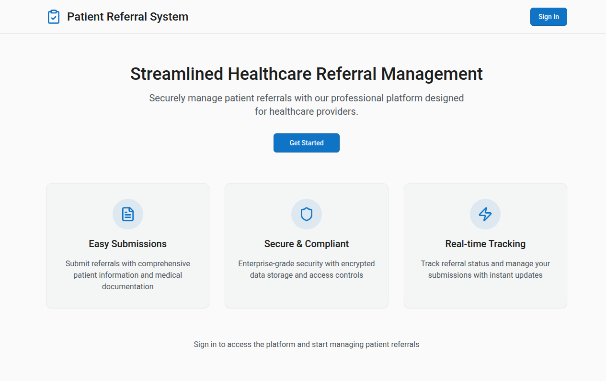

## Contents

- [Features](#features)
- [How it works](#how-it-works)
- [Requirements](#requirements)
- [Installation (Docker)](#installation-docker)
- [First-time setup](#first-time-setup)
- [Using the app](#using-the-app)
- [Troubleshooting](#troubleshooting)
- [Configuration](#configuration)
- [Development](#development)
- [Security notes](#security-notes)
- [Acknowledgments](#acknowledgments)

## Features

- **Referral form**: patient demographics, diagnosis with ICD-10 search,
  urgency, referral reason, medical history, current medications, insurance and
  the referring provider.
- **Sent straight to OpenEMR**: the patient, encounter, insurance, medical
  problems and medications are created in OpenEMR when the referral is
  submitted.
- **Documents**: attach referral letters, lab results or insurance cards (PDF,
  images, Word, text). They are uploaded to the patient's chart in OpenEMR.
- **NPI lookup**: fill in the referring provider from the national NPI registry
  and add them to the OpenEMR Address Book.
- **Pull from OpenEMR**: import encounters created in OpenEMR so patients and
  their history show up in the app.
- **Users and roles**: admins see everything; referring providers see only their
  own referrals. Providers can sign up and are activated by an admin.
- **Browser setup wizard**: create the admin account and connect OpenEMR on
  first visit; no client IDs or secrets to copy into config files.
- **Email notifications** (optional, via Mailgun) for new referrals.

## How it works

```
Referring provider ──► Referral app ──(OAuth2 + OpenEMR REST API)──► OpenEMR
   (browser)          (Docker: Node.js + PostgreSQL)
```

The app registers itself in OpenEMR as an API client (OAuth2 dynamic client
registration). An OpenEMR user approves the connection once, and from then on
the app creates patients, encounters and documents with that access.

## Requirements

- A server with **Docker** and Docker Compose (for example a Synology NAS).
- **OpenEMR 7 or later** with its API turned on. In OpenEMR, go to **Admin →
  Config → Connectors** and:
  - set **Site Address** to OpenEMR's own public `https://` address (OAuth2
    needs it);
  - enable **OpenEMR Standard REST API** and **OpenEMR Standard FHIR REST API**.
- For real use: a **domain name with HTTPS** for the app (see
  [step 5](#5-put-it-behind-a-domain-with-https)).

## Installation (Docker)

Docker Compose runs the app and its own PostgreSQL database. These steps were
tested on a Synology NAS, but work on any Linux host with Docker.

### 1. Get the code

```bash
git clone <this-repo-url> referral
cd referral
```

### 2. Create the `.env` file

```bash
sh setup-env.sh
```

This copies `.env.example` to `.env` and fills in a random `POSTGRES_PASSWORD`
and `SESSION_SECRET`. Running it again is safe: it only replaces placeholder
values. Don't change `POSTGRES_PASSWORD` after the first start, or the app can
no longer open its database.

### 3. Pick free ports

The app listens on `APP_PORT` (default `3001`) and the database on `DB_PORT`
(default `15432`). If either is taken, change it in `.env`:

```bash
APP_PORT=3001
DB_PORT=15432
```

> On Synology, avoid `5000`/`5001` (DSM) and `3000`, which other packages often
> use. If `docker compose up` says `port is already allocated`, pick another
> port and run it again.

### 4. Start it

```bash
sudo docker compose up -d --build
```

The first build takes a few minutes. Check that it started:

```bash
sudo docker compose ps
sudo docker compose logs --tail=50 app    # should end with "serving on port 3001"
```

The database schema is created automatically on every start.

### 5. Put it behind a domain with HTTPS

You can test with `http://<server-ip>:3001` from your own network, but for real
use put the app behind HTTPS:

- doctors outside the clinic need to reach it;
- OpenEMR runs on HTTPS, and sending the sign-in back to a plain `http://`
  address makes the browser warn that the form is not secure;
- patient data shouldn't travel over plain HTTP.

On Synology:

1. **DNS:** add an A record (for example `referral.yourdomain.com`) pointing to
   your public IP, and forward ports 80 and 443 on your router to the NAS.
2. **Reverse proxy:** **Control Panel → Login Portal → Advanced → Reverse Proxy
   → Create**:

   | | Protocol | Hostname | Port |
   |---|---|---|---|
   | Source | HTTPS | `referral.yourdomain.com` | 443 |
   | Destination | HTTP | `localhost` | `3001` |

3. **Certificate:** **Control Panel → Security → Certificate → Add → Let's
   Encrypt** for the same hostname, then under **Settings** assign it to the
   reverse proxy entry.

### Updating

```bash
git pull
sudo docker compose up -d --build
```

Data lives in the `postgres_data` Docker volume and survives rebuilds. Uploaded
documents are stored in the database too.

### Starting over

To wipe everything (users, the OpenEMR connection, referrals and documents) and
run the setup wizard again:

```bash
sudo docker compose down -v
sudo docker compose up -d
```

`down -v` deletes only this project's database volume. `.env` is kept.

## First-time setup

Open the app: the local address (`http://<server-ip>:3001`) for testing, or the
public domain (`https://referral.yourdomain.com`) in production. Until an admin
account exists, every visit goes to `/setup`, which walks you through the steps
below.

### Step 1: Create the admin account

Enter your name, email, a username and a password (8+ characters). New-referral
notifications go to this email; you can change it later.

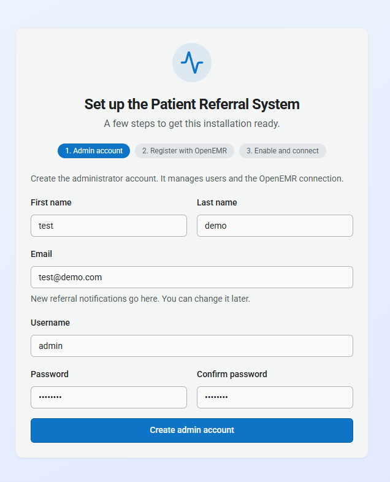

### Step 2: Register with OpenEMR

| Field | What to enter |
|-------|---------------|
| **OpenEMR address** | The address you open OpenEMR at, without `/interface` or `/login`, e.g. `https://emr.yourdomain.com`. The app's server must be able to reach it. |
| **This app's address** | Pre-filled from the address bar. For testing, the local address is fine (e.g. `http://192.168.1.10:3001`). In production, use the public `https://` domain. |
| **Application name** | How the app shows up in OpenEMR's list of API clients. |

Click **Register with OpenEMR**. The app sends OpenEMR's dynamic client
registration request to `<OpenEMR address>/oauth2/default/registration` with the
redirect URI `<app address>/api/oauth/callback`, and saves the client ID and
secret in its database.

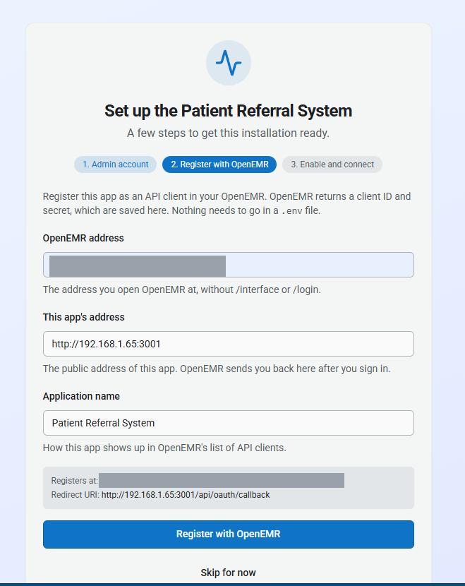

> **Testing or production?**
>
> - **Testing:** the local address (`http://<server-ip>:3001`) works from any
>   computer on the same network. That's what this screenshot uses. After
>   OpenEMR sign-in the browser may warn that the form is not secure; click
>   **Send anyway**.
> - **Production:** use the public `https://` domain, so doctors outside the
>   clinic can reach the app and patient data is encrypted.
>
> When you move from testing to production, register again with the new
> address (the redirect URI is saved in OpenEMR) and enable the new client.

### Step 3: Enable the client in OpenEMR

OpenEMR adds new API clients switched off. The app shows what to do and links
straight to the right OpenEMR page.

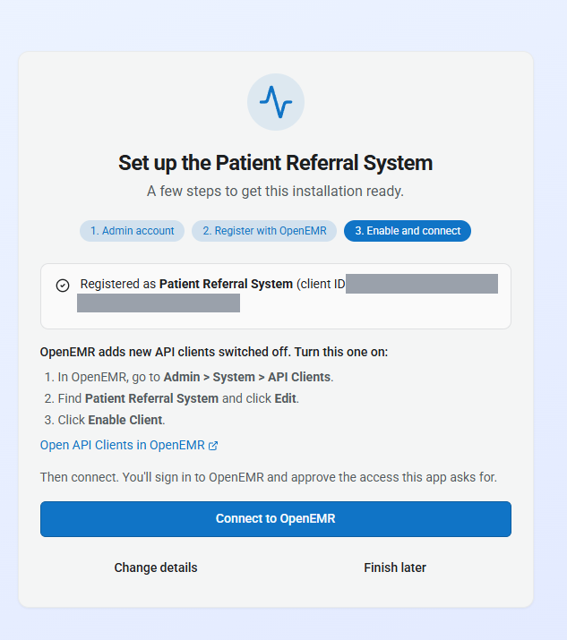

1. In OpenEMR, go to **Admin → System → API Clients**.
2. Find your application name and click **Edit**. It shows *This client is
   currently disabled*, with the scopes the app asked for.

   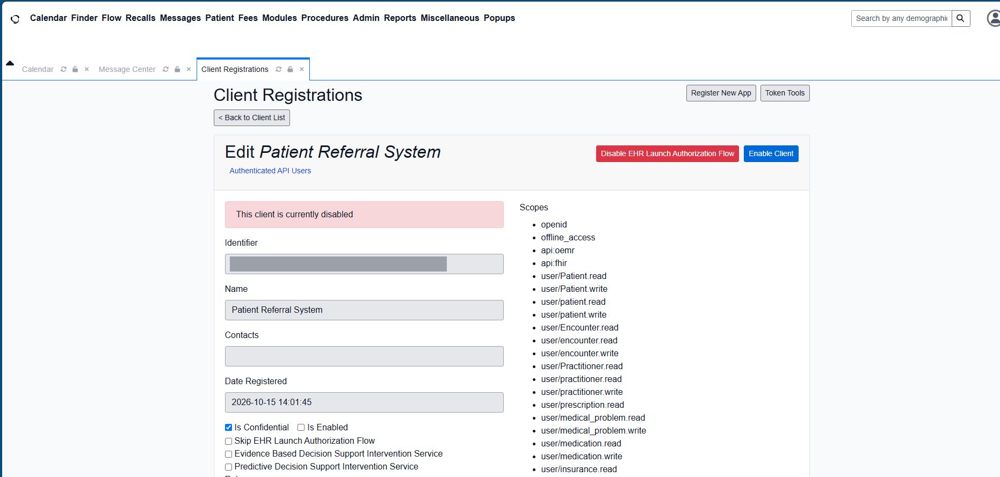

3. Click **Enable Client**. The page shows *Enabled Client* and **Is Enabled**
   is ticked.

   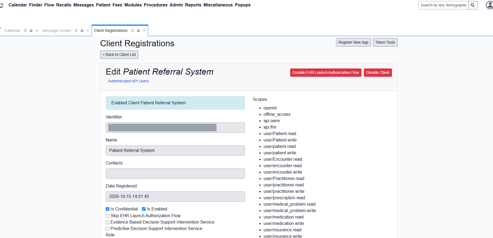

### Step 4: Connect

Back in the app, click **Connect to OpenEMR**.

1. Sign in with an OpenEMR user. The app works with this user's permissions, so
   use an account that can create patients and encounters.

   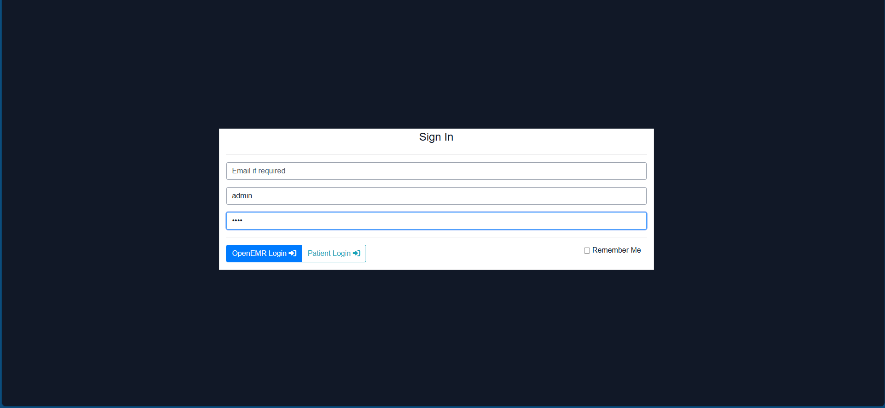

2. Review the requested access, keep **Allow Offline Access** ticked (so the app
   stays connected), and click **Authorize**.

   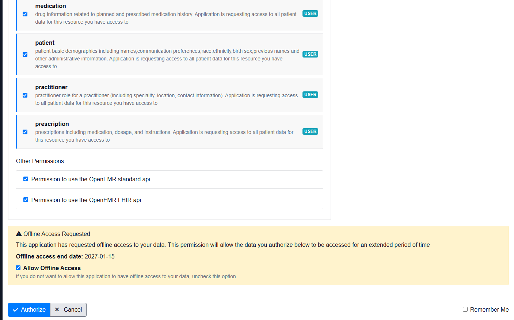

   **Testing on a local `http://` address?** After **Authorize** the browser
   shows *The information you're about to submit is not secure*. This is
   expected: OpenEMR (on `https://`) is sending you back to an `http://`
   address. Click **Send anyway** to continue. You won't see this in production
   with the app on its `https://` domain.

   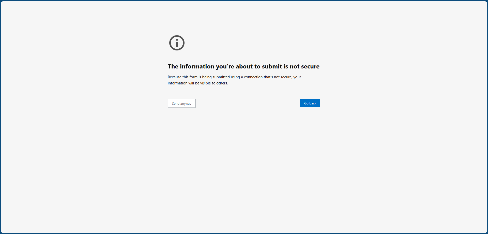

3. You're sent back to the app: **Authorization Successful**.

   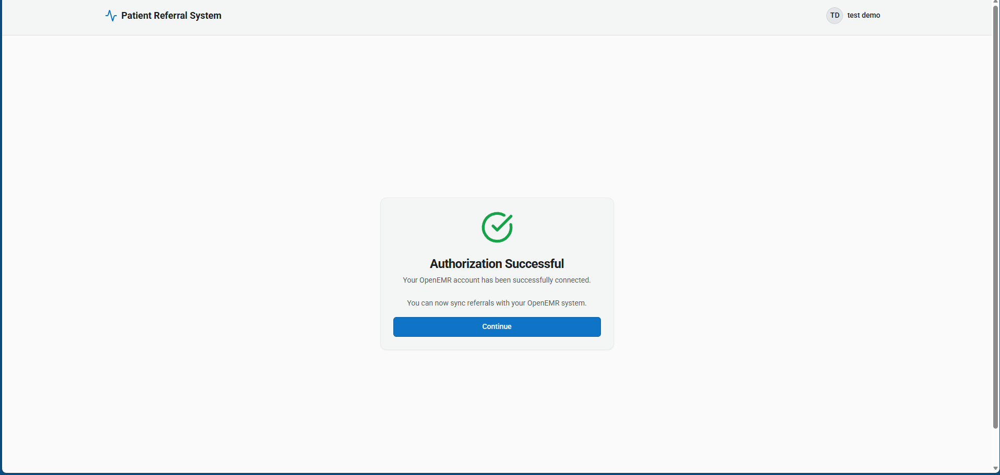

The app is ready. Admins can rerun steps 2–4 any time from **Admin Dashboard →
OpenEMR Integration → OpenEMR Setup**.

**Register again when:**

- the app's address changes (for example, from the IP to the domain), because
  the redirect URI is saved in OpenEMR;
- an update adds OpenEMR scopes, so OpenEMR grants the new access.

> For unattended installs, set `DEFAULT_ADMIN_PASSWORD` to pre-create a user
> named `admin`, and the `OPENEMR_*` variables to skip the wizard.

## Using the app

### Patients

After signing in you land on **Patients**. Start a referral with **New
Referral**, or import existing encounters with **Pull from OpenEMR**.

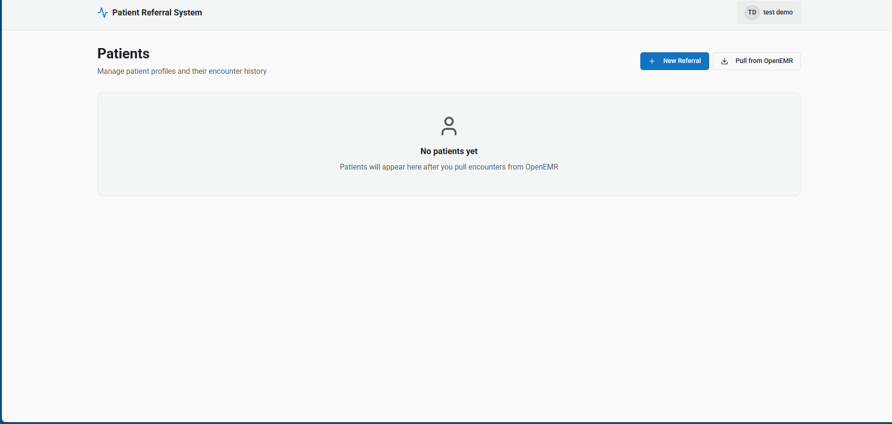

### Creating a referral

**Step 1: Patient.** Pick an existing patient or create a new one. The address
is required because OpenEMR needs it to accept the patient's insurance.

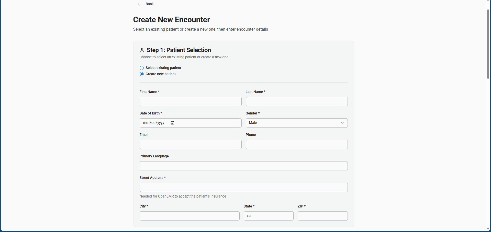

**Step 2: Encounter details.** Diagnosis, urgency and an optional ICD-10 code
(search by code or description). Put one condition per line in **Medical
History** and one medication per line in **Current Medications**: each line
becomes an entry in OpenEMR's Medical Problems or Medications list.

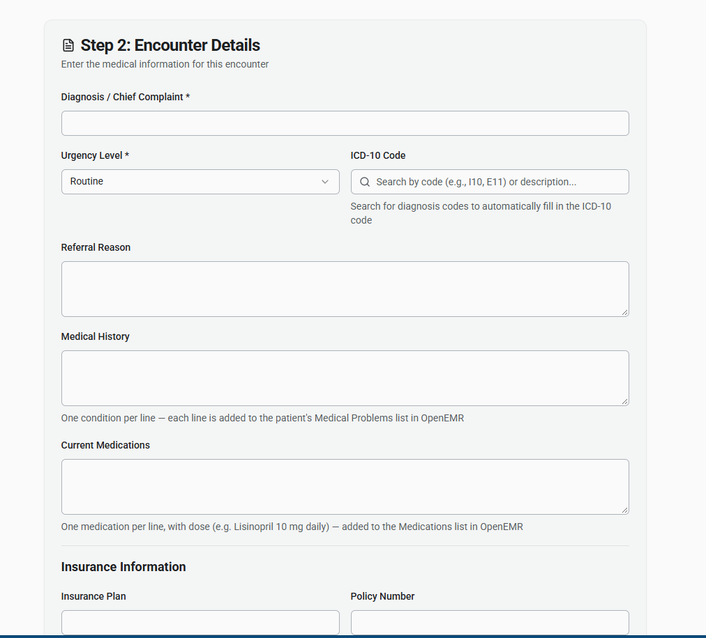

**Insurance and referring provider.** Insurance is optional, but once you fill
in any insurance field, the plan, policy number and dates are required. Enter
the referring provider's **NPI** and click **Look up** to fill in their details
and add them to the OpenEMR Address Book.

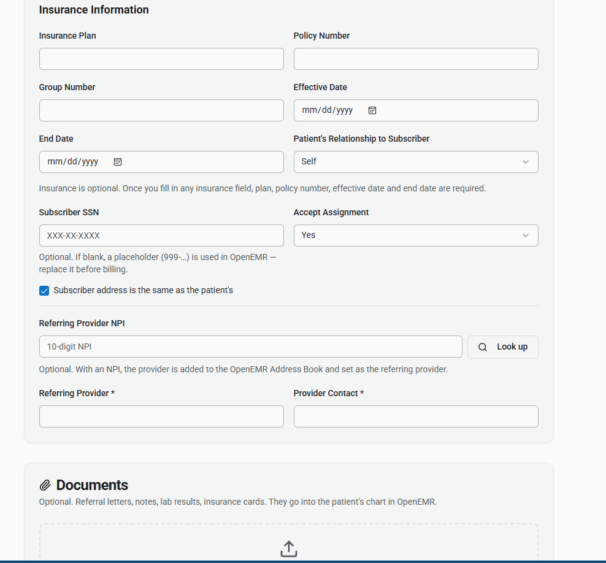

**Documents.** Drag files in or click **Choose files**: PDF, images, Word or
text, up to 10 files of 10 MB each. Each file uploads as soon as you add it.
Then click **Create Encounter**.

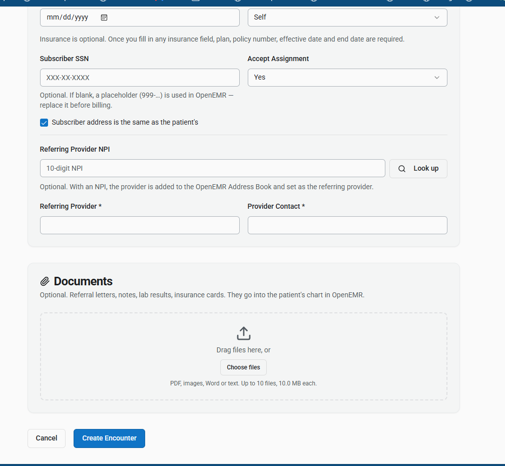

When the referral is created, the app sends it to OpenEMR and then uploads the
documents to the patient's chart, in the **Medical Record** category (set
`OPENEMR_DOCUMENT_CATEGORY` to use another). The referral page shows each
file's status; if a file fails, admins can resend it with **Send to OpenEMR**.

### Admin dashboard

Admins see totals, set the notification email and promote other users to admin.

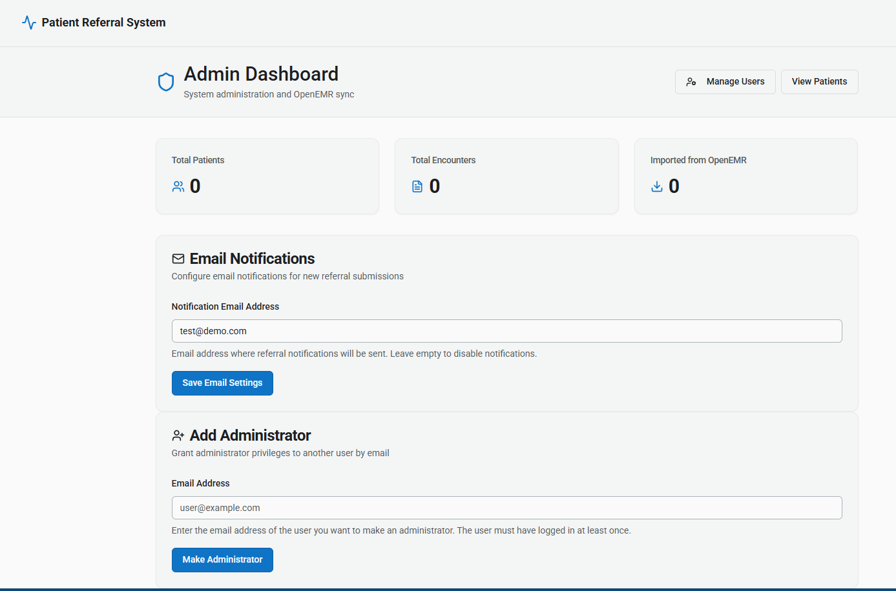

The **OpenEMR Integration** section reruns the setup, reconnects, pulls
encounters from OpenEMR, and cleans up unsynced test data.

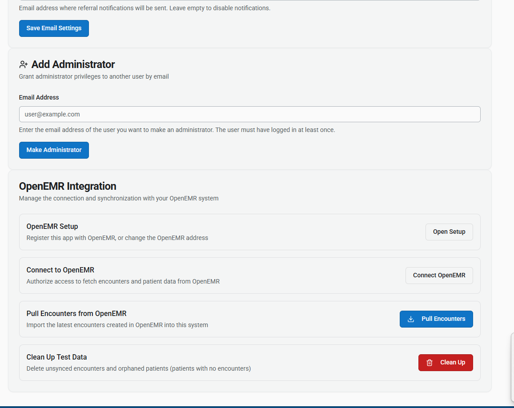

### Users

**Admin Dashboard → Manage Users** lists everyone, with their role and status.
Create accounts with **Create User**. Providers who sign up on their own (at
`/register`, with their NPI) stay inactive until an admin activates them here.

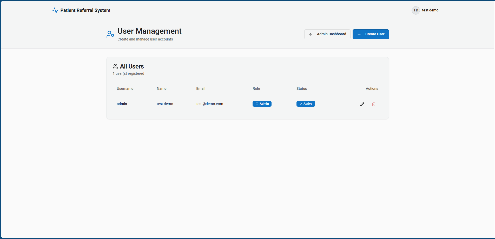

## Troubleshooting

| Problem | Fix |
|---------|-----|
| Browser says **connection refused** | The container isn't running. Check `sudo docker compose ps` and `sudo docker compose logs app`. |
| `port is already allocated` | Change `APP_PORT` or `DB_PORT` in `.env` and run `sudo docker compose up -d` again. |
| Logs repeat `Waiting for PostgreSQL` | The database didn't start. Check `sudo docker compose logs postgres`. |
| OpenEMR registration fails | Check the app's server can reach the OpenEMR address, and that the REST APIs are on (**Admin → Config → Connectors**). |
| After **Authorize**: *The information you're about to submit is not secure* | The app was registered with an `http://` address. Fine for testing: click **Send anyway**. In production, open the app at its `https://` domain and register again (step 2). |
| **Connect** fails with `invalid_client` | The client isn't enabled in OpenEMR yet (step 3). |
| Documents show **Not sent** | Make sure the category in `OPENEMR_DOCUMENT_CATEGORY` exists in OpenEMR, then click **Send to OpenEMR** on the referral page. |

## Configuration

All configuration is via environment variables; see [`.env.example`](.env.example)
for the full list with descriptions. The essentials:

| Variable | Purpose |
|----------|---------|
| `POSTGRES_PASSWORD` | Database password (set by `setup-env.sh`) |
| `SESSION_SECRET` | Random 32+ character string for signing sessions (set by `setup-env.sh`) |
| `APP_PORT` / `DB_PORT` | Host ports for the app (default `3001`) and database (default `15432`) |
| `OPENEMR_DOCUMENT_CATEGORY` | OpenEMR category for referral documents (default `/Medical Record`) |
| `MAILGUN_*` | Optional email notifications |
| `DEFAULT_ADMIN_PASSWORD` | Optional: pre-create an `admin` user instead of using the wizard |
| `OPENEMR_BASE_URL` / `OPENEMR_CLIENT_ID` / `OPENEMR_CLIENT_SECRET` | Optional: OpenEMR client, if not set up with the wizard |
| `DATABASE_URL` | PostgreSQL connection string (set by `docker-compose.yml`; needed for development) |

## Development

### Tech stack

| Layer    | Technology |
|----------|------------|
| Frontend | React + TypeScript, Vite, Wouter, TanStack Query, React Hook Form + Zod |
| UI       | shadcn/ui (Radix UI), Tailwind CSS |
| Backend  | Express.js + TypeScript (Node.js) |
| Database | PostgreSQL via Drizzle ORM |
| Auth     | Passport (local), bcrypt; OAuth2 to OpenEMR |

### Running locally

Requires Node.js 20+ and PostgreSQL 16+.

```bash
npm install
cp .env.example .env     # set DATABASE_URL, SESSION_SECRET, STANDALONE_MODE=true
npm run db:push          # create the database tables
npm run dev              # http://localhost:5000
```

### Scripts

| Command | Description |
|---------|-------------|
| `npm run dev` | Start the development server (hot reload) |
| `npm run build` | Build client and server for production |
| `npm run start` | Run the production build |
| `npm run check` | TypeScript type-check |
| `npm run db:push` | Apply the Drizzle schema to the database |

### Project structure

```
client/        React frontend (components, pages, hooks, lib)
server/        Express API, auth, OpenEMR integration
shared/        Database schema and Zod schemas shared by client and server
docs/          Screenshots used in this README
migrations/    Drizzle SQL migrations
scripts/       One-off maintenance scripts
```

## Security notes

- Never commit real secrets. `.env` and all `.env.*` files (except
  `.env.example`) are git-ignored.
- Serve the app over HTTPS in production.
- If you set `DEFAULT_ADMIN_PASSWORD`, change it on first login.
- This project handles health information. Review your own regulatory
  obligations (e.g. HIPAA) before deploying with real patient data.

## Acknowledgments

Conceived, designed and developed by **Julian Clarke**.

Built for and tested at **Unemori Dermatology Associates**, with clinical
workflow input from **Dr. Patrick Unemori**.

Development assisted by **Claude** (Anthropic).

Screenshots use a demo OpenEMR instance with fictional patient data.

## License

[MIT](LICENSE)
